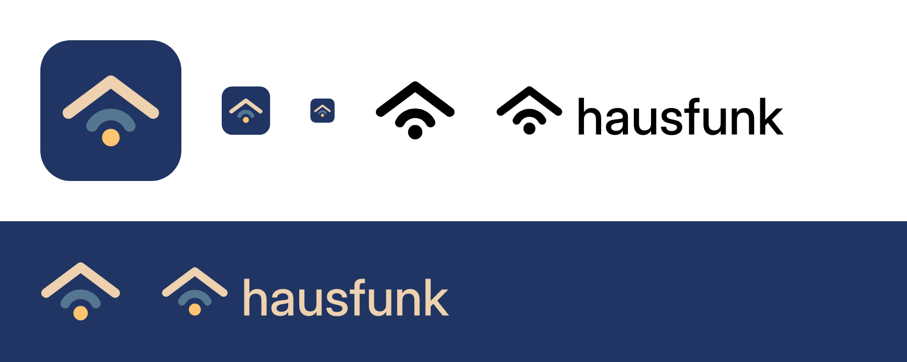

# Brand

A roof over a radio wave over a dot: a house (*Haus*) sending a signal (*Funk*) from what matters
inside it.

**Rule:** the colour logo only goes on a dark background (navy or darker). On anything light,
use the single-colour version in black (or the text colour of the surface it sits on).

| File | Use |
| --- | --- |
| `app-icon.svg` | app icon, mark on a navy tile |
| `logo-mark.svg` | mark, colour, dark backgrounds only |
| `logo-mark-black.svg` | mark, single colour, light backgrounds |
| `logo-lockup.svg` | mark + wordmark, colour, dark backgrounds only |
| `logo-lockup-black.svg` | mark + wordmark, single colour, light backgrounds |

The wordmark is Inter Display Medium (SIL OFL), converted to outlines, so the files need no font.

| Colour | Hex | Logo | App, light theme | App, dark theme |
| --- | --- | --- | --- | --- |
| Navy | `#203563` | background | primary | high surfaces |
| Steel | `#557691` | wave | secondary | secondary container |
| Sand | `#EED1AF` | roof, wordmark | highest surface (cards) | secondary |
| Amber | `#FFC46F` | dot | tertiary container | primary |

The app uses these fixed colours (`ui/theme/Theme.kt`), not the phone's dynamic colours, so it
looks the same on every device and in every screenshot.
